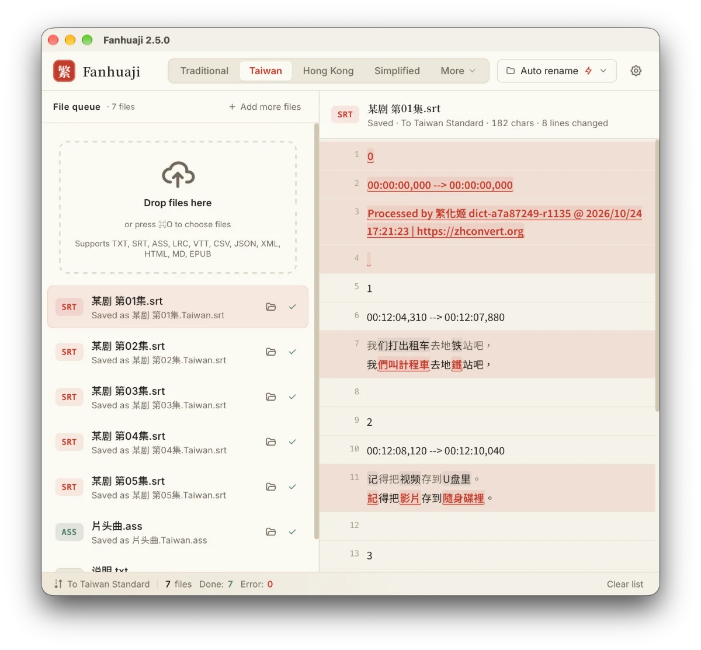

# Fanhuaji (繁化姬) Tauri Edition

English | [正體中文](README.zh-TW.md)

[](https://github.com/fanhuaji-desktop/fanhuaji-tauri/actions/workflows/ci.yml)
[](https://codecov.io/gh/fanhuaji-desktop/fanhuaji-tauri)

A desktop app for converting subtitles, documents and EPUB books between Traditional and Simplified Chinese, built with Tauri 2 and powered by the [Fanhuaji (zhconvert.org)](https://zhconvert.org) API.

> This is a third-party client, not an official Fanhuaji product.

**Website:** <https://fanhuaji-desktop.github.io/en/>



## Download

Get the latest version from [Releases](https://github.com/fanhuaji-desktop/fanhuaji-tauri/releases):

| Platform | Architecture | Format |
|----------|--------------|--------|
| macOS | Universal (Apple Silicon + Intel) | `.dmg` |
| Windows | x86_64 | `.exe` (NSIS installer) / portable `.zip` |
| Linux | x86_64 | `.AppImage` / `.deb` |
| Linux | ARM64 (aarch64) | `.AppImage` / `.deb` |

The app updates itself: it checks for a new version on launch. The Windows portable build does not update itself; it only tells you when a new version is out.

### Homebrew (macOS)

```bash
brew install --cask 7a6163/tap/fanhuaji
```

### Opening on macOS for the first time

The app is not signed by Apple, so macOS will say it cannot be opened. To open it:

1. Click **Done**
2. Go to **System Settings → Privacy & Security**
3. Scroll down to "Fanhuaji was blocked" and click **Open Anyway**

Or run this in Terminal:

```bash
xattr -cr /Applications/Fanhuaji.app
```

### Linux Wayland issue

On Wayland (e.g. Omarchy, GNOME on Wayland), the AppImage may fail with `could not create surfaceless EGL display`. Launch it like this instead:

```bash
WEBKIT_DISABLE_DMABUF_RENDERER=1 ./Fanhuaji.AppImage
```

## Features

- Drag and drop files to convert them automatically, no clicks needed
- Supports txt, srt, ass, lrc, vtt, csv, json, xml, html, md, and **epub**
- EPUB conversion chapter by chapter, keeping structure, CSS, and images
- Line-by-line preview of the original and the result, with every change marked
- Overwriting the original backs it up first, so **Undo** can put it back until you quit
- Stop a batch in progress; remove single files or clear finished ones
- Keyboard-friendly: move through files with the arrow keys, ⌘/Ctrl+O to add files, ⌘/Ctrl+Enter to convert
- Multiple conversion modes: Traditional, Simplified, Taiwan, Hong Kong, China, Bopomofo, Pinyin, and more
- Dictionary module settings (auto-detect / enabled / disabled)
- Custom replacement rules (pre-conversion, post-conversion, protected terms)
- Custom output folder
- Flexible file naming (automatic, custom suffix, or overwrite the original)
- All settings are remembered across restarts
- Choose whether dropped files start converting automatically
- Interface in English, Traditional Chinese, and Simplified Chinese
- Dark / light theme
- In-app auto-update

## Development

### Requirements

- [Node.js](https://nodejs.org/) >= 18
- [Rust](https://www.rust-lang.org/tools/install) >= 1.77
- Tauri 2 system dependencies (see the [Tauri docs](https://v2.tauri.app/start/prerequisites/))

### Commands

```bash
# Install frontend dependencies
npm install

# Run in development mode (Tauri window + Vite HMR)
npm run tauri dev

# Production build
npm run tauri build

# Checks and tests (what CI runs)
npm run check && npm test
cd src-tauri && cargo clippy -- -D warnings && cargo fmt --check && cargo test
```

### Releasing a new version

1. Move the `[Unreleased]` notes in `CHANGELOG.md` under the new version, then bump the version:

```bash
# Updates package.json, package-lock.json, src-tauri/tauri.conf.json, and src-tauri/Cargo.toml together
npm version <major|minor|patch>
```

2. Push the tag to trigger the GitHub Actions build:

```bash
git push && git push --tags
```

GitHub Actions builds every platform and creates the Release (including `latest.json` for auto-update).

## Tech stack

| Layer | Technology |
|-------|------------|
| Frontend | TypeScript + Vite (no framework, native DOM) |
| Backend | Rust + Tauri 2 |
| API | [zhconvert.org](https://api.zhconvert.org) |
| CI/CD | GitHub Actions (cross-platform builds) |
| Updates | tauri-plugin-updater (in-app auto-update) |

## License

The source code is released under the [MIT](LICENSE) license.

This app uses the [Fanhuaji](https://docs.zhconvert.org/) API; use of the API is subject to Fanhuaji's [terms of service](https://docs.zhconvert.org/license/). For commercial use, see Fanhuaji's [license terms](https://docs.zhconvert.org/license/).
