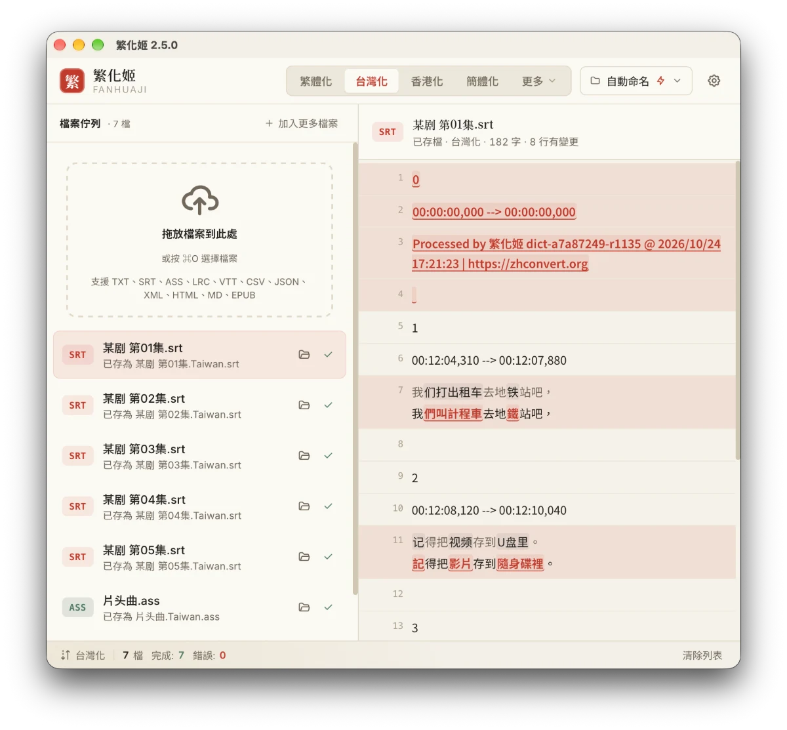

# 繁化姬 Tauri 版

[English](README.md) | 正體中文

[](https://github.com/fanhuaji-desktop/fanhuaji-tauri/actions/workflows/ci.yml)
[](https://codecov.io/gh/fanhuaji-desktop/fanhuaji-tauri)

字幕、文件、EPUB 電子書的繁簡轉換桌面應用程式，以 Tauri 2 撰寫，轉換服務由[繁化姬（zhconvert.org）](https://zhconvert.org) API 提供。

> 這是第三方用戶端，並非繁化姬官方產品。

**官網：** <https://fanhuaji-desktop.github.io/>



## 下載

前往 [Releases](https://github.com/fanhuaji-desktop/fanhuaji-tauri/releases) 下載最新版本：

| 平台 | 架構 | 格式 |
|------|------|------|
| macOS | Universal (Apple Silicon + Intel) | `.dmg` |
| Windows | x86_64 | `.exe`（NSIS 安裝程式）/ 免安裝版 `.zip` |
| Linux | x86_64 | `.AppImage` / `.deb` |
| Linux | ARM64 (aarch64) | `.AppImage` / `.deb` |

應用程式內建自動更新，啟動時會自動檢查新版本。Windows 免安裝版不會自動更新，有新版本時只會通知。

### Homebrew（macOS）

```bash
brew install --cask 7a6163/tap/fanhuaji
```

### macOS 首次開啟

由於應用程式未經 Apple 簽名，macOS 會顯示「無法打開」的警告。請依以下步驟操作：

1. 點擊 **Done**（完成）
2. 前往 **系統設定 → 隱私與安全性**
3. 往下滑找到「Fanhuaji was blocked」，點擊 **仍要打開**

或在終端機執行：

```bash
xattr -cr /Applications/Fanhuaji.app
```

### Linux Wayland 問題

在 Wayland 環境下（如 Omarchy、GNOME on Wayland），AppImage 可能出現 `could not create surfaceless EGL display` 錯誤。請使用以下方式啟動：

```bash
WEBKIT_DISABLE_DMABUF_RENDERER=1 ./Fanhuaji.AppImage
```

## 功能

- 拖放檔案即自動轉換，零點擊操作
- 支援 txt、srt、ass、lrc、vtt、csv、json、xml、html、md、**epub** 等格式
- EPUB 電子書轉換（逐章轉換，保留結構/CSS/圖片）
- 逐句對照預覽原文與轉換結果，改動處會標出來
- 覆蓋原檔前先備份，結束 App 前都能按「復原」放回原檔
- 轉換中可停止；可移除單一檔案或清除已完成
- 鍵盤操作：方向鍵切換檔案，⌘/Ctrl+O 加入檔案，⌘/Ctrl+Enter 開始轉換
- 多種轉換模式：繁體化、簡體化、台灣化、香港化、中國化、注音化、拼音化等
- 詞語模組設定（自動偵測 / 啟用 / 停用）
- 自訂取代規則（轉換前取代、轉換後取代、保護詞彙）
- 自訂輸出資料夾
- 彈性命名方式（自動命名、自訂後綴、覆蓋原檔）
- 所有設定自動記憶（重啟後保留）
- 可選擇拖入檔案後是否自動開始轉換
- 多語言介面（正體中文、簡體中文、English）
- 深色/淺色主題切換
- 應用程式內自動更新

## 開發

### 系統需求

- [Node.js](https://nodejs.org/) >= 18
- [Rust](https://www.rust-lang.org/tools/install) >= 1.77
- Tauri 2 系統相依套件（參考 [Tauri 官方文件](https://v2.tauri.app/start/prerequisites/)）

### 指令

```bash
# 安裝前端相依套件
npm install

# 啟動開發模式（Tauri 視窗 + Vite HMR）
npm run tauri dev

# 正式建置
npm run tauri build

# 檢查與測試（與 CI 相同）
npm run check && npm test
cd src-tauri && cargo clippy -- -D warnings && cargo fmt --check && cargo test
```

### 發布新版本

1. 把 `CHANGELOG.md` 的 `[Unreleased]` 改成新版本，然後更新版本號：

```bash
# 會同時更新 package.json、package-lock.json、src-tauri/tauri.conf.json、src-tauri/Cargo.toml
npm version <major|minor|patch>
```

2. 推送 tag 觸發 GitHub Actions 自動建置：

```bash
git push && git push --tags
```

GitHub Actions 會自動為所有平台建置並建立 Release（含 `latest.json` 供自動更新）。

## 技術架構

| 層級 | 技術 |
|------|------|
| 前端 | TypeScript + Vite（無框架，原生 DOM） |
| 後端 | Rust + Tauri 2 |
| API  | [zhconvert.org](https://api.zhconvert.org) |
| CI/CD | GitHub Actions（跨平台自動建置） |
| 更新 | tauri-plugin-updater（應用程式內自動更新） |

## 授權

本程式原始碼以 [MIT](LICENSE) 授權釋出。

本程式使用了[繁化姬](https://docs.zhconvert.org/)的 API 服務，其使用須遵守繁化姬的[服務條款](https://docs.zhconvert.org/license/)。商業使用請參閱繁化姬[授權條款](https://docs.zhconvert.org/license/)。
